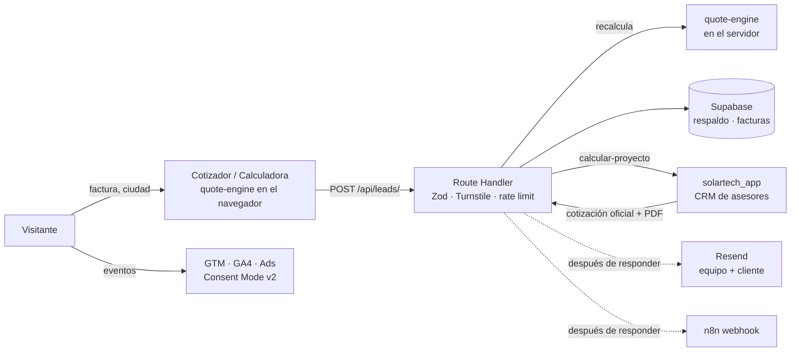

<div align="center">

# Solartech · solartechenergy.co

**Sitio web y cotizador solar de Solartech, empresa de energía solar del grupo Ferragro (Colombia).**

[](https://github.com/pradadeveloper/solartech_web/actions/workflows/ci.yml)


</div>

---

## Contenido

- [Qué es](#qué-es)
- [Funcionalidades](#funcionalidades)
- [Stack](#stack)
- [Arquitectura](#arquitectura)
- [Primeros pasos](#primeros-pasos)
- [Variables de entorno](#variables-de-entorno)
- [Scripts](#scripts)
- [Estructura del proyecto](#estructura-del-proyecto)
- [Gestión de contenido](#gestión-de-contenido)
- [Cotizador](#cotizador)
- [Leads y backend](#leads-y-backend)
- [CRM de asesores (solartech_app)](#crm-de-asesores-solartech_app)
- [SEO](#seo)
- [Analítica y privacidad](#analítica-y-privacidad)
- [Diseño](#diseño)
- [Calidad y CI](#calidad-y-ci)
- [Despliegue](#despliegue)
- [Licencia](#licencia)

---

## Qué es

Reconstrucción completa del sitio de Solartech. Reemplaza al WordPress + Elementor anterior con un sitio rápido, orientado a SEO y a la captura de leads. El centro de la experiencia es un **cotizador solar** que entrega en menos de un minuto:

- el tamaño del sistema;
- el ahorro mensual;
- la inversión estimada y el retorno;
- el beneficio tributario de la Ley 1715;
- la alternativa sin inversión (PPA).

Todo con la radiación real del municipio del visitante.

## Funcionalidades

| Área | Detalle |
|---|---|
| **Cotizador** | Wizard de 4 pasos con estimación en vivo. Resultado con flujo de caja a 25 años, comparación EPC/PPA, PDF descargable y caso de éxito similar. Paso 1 embebido en el home. |
| **Calculadora de ahorro** | Versión rápida (`/calculadora-ahorro/`): factura → ahorro, sin formulario. |
| **Captura de leads** | API propia con validación Zod, Turnstile, honeypot, rate limit, carga de factura, scoring, correos y webhook a n8n. Respaldo de cada lead en Supabase. |
| **CRM** | Cada cotización entra al CRM de asesores (`solartech_app`), que devuelve la cotización oficial y su PDF al visitante. |
| **Casos de éxito** | 35 proyectos (industria, comercio, agro, hogares y copropiedades PPA), listado con filtros y fichas con cifras. |
| **Servicios y soluciones** | PPA, EPC, gestión de plantas; soluciones para empresas, agro, hogares e híbridos; financiación EPC / PPA / leasing. |
| **SEO local** | 10 landings por ciudad con radiación, operador de red, escenarios de ahorro y FAQ propios. |
| **Blog** | MDX con tabla de contenidos, relacionados, RSS, imágenes OG dinámicas y flujo de borradores para revisión editorial. |
| **Migración** | 118 redirecciones 301 desde las URLs del WordPress anterior. |
| **Experiencia** | Tema claro y oscuro, video de fondo optimizado (no afecta el LCP), mobile-first, accesibilidad con objetivo WCAG 2.1 AA. |

## Stack

- **Framework:** [Next.js 15](https://nextjs.org) (App Router, generación estática), React 19, TypeScript.
- **Estilos:** Tailwind CSS v4 con design tokens propios; `next-themes`; íconos `lucide-react`.
- **Contenido:** archivos TypeScript y MDX en el repo (`next-mdx-remote`, `gray-matter`).
- **Formularios y validación:** `react-hook-form` + Zod (mismos esquemas en cliente y servidor).
- **Datos:** Supabase (Postgres + Storage, RLS).
- **Correo y PDF:** Resend y `@react-pdf/renderer`.
- **Gráficas:** Recharts.
- **Anti-spam:** Cloudflare Turnstile.
- **Hosting:** Vercel.
- **Pruebas:** Vitest (unitarias), Playwright (E2E), Lighthouse CI.

## Arquitectura



- **Un solo motor de cálculo** (`src/lib/quote-engine.ts`, funciones puras) que corre en el navegador para la vista previa y en el servidor antes de guardar el lead. El servidor nunca confía en cifras enviadas por el cliente.
- **Páginas estáticas** (SSG). Solo las rutas `/api/*` son dinámicas.

## Primeros pasos

**Requisitos:** Node.js 22 LTS (funciona con 20, pero Supabase dejará de soportarlo) y npm.

```bash
git clone https://github.com/pradadeveloper/solartech_web.git
cd solartech_web
npm install
cp .env.example .env.local   # completa los valores (ver abajo)
npm run dev                  # http://localhost:3000
```

**Sin cuentas externas:** en desarrollo, el formulario funciona sin Supabase ni Turnstile; los leads se registran en la consola. Para probar el build de producción en local sin servicios externos:

```bash
npm run build
LEADS_DRY_RUN=1 npm start    # PowerShell: $env:LEADS_DRY_RUN="1"; npm start
```

## Variables de entorno

Plantilla completa en [`.env.example`](.env.example). Nunca subas `.env.local`.

| Variable | Uso | Requerida en producción |
|---|---|---|
| `NEXT_PUBLIC_SITE_URL` | URL canónica del sitio | ✅ |
| `NEXT_PUBLIC_GTM_ID` | Contenedor de Google Tag Manager | ✅ |
| `NEXT_PUBLIC_SUPABASE_URL` / `NEXT_PUBLIC_SUPABASE_ANON_KEY` | Proyecto de Supabase | ✅ |
| `SUPABASE_SERVICE_ROLE_KEY` | Escritura de leads desde el servidor (**solo servidor**) | ✅ |
| `NEXT_PUBLIC_TURNSTILE_SITE_KEY` / `TURNSTILE_SECRET_KEY` | Anti-spam | ✅ |
| `RESEND_API_KEY`, `LEADS_FROM_EMAIL`, `LEADS_NOTIFY_TO` | Correos al equipo y al cliente | ✅ |
| `N8N_LEADS_WEBHOOK_URL` | Automatizaciones (Sheets, CRM, WhatsApp) | Opcional |
| `SOLARTECH_APP_API_URL` | API del CRM de asesores (`solartech_app`), **solo servidor** | ✅ |
| `IP_HASH_SALT` | Hash de IP para rate limit sin guardar IPs | ✅ |
| `LEADS_DRY_RUN` | Solo pruebas E2E/CI: acepta leads sin servicios externos | ❌ **Nunca** |

## Scripts

| Comando | Qué hace |
|---|---|
| `npm run dev` | Servidor de desarrollo |
| `npm run build` · `npm start` | Build y servidor de producción |
| `npm run lint` · `npm run typecheck` | ESLint y TypeScript |
| `npm test` | Pruebas unitarias del motor de cálculo (Vitest) |
| `npm run test:e2e` | Pruebas E2E del cotizador y la calculadora (Playwright; requiere `npm run build`) |
| `npm run seo:audit` | Auditoría SEO de todas las URLs del sitemap (servidor en `:3100`) |
| `npm run screenshots -- <carpeta> [rutas]` | Capturas en tema claro y oscuro, escritorio y móvil |
| `node scripts/encode-hero-video.mjs` | Re-codifica el video del hero (MP4/WebM, escritorio y móvil) con el Chrome instalado |

## Estructura del proyecto

```
├── .github/workflows/ci.yml     # CI: lint, tipos, pruebas, build, E2E, Lighthouse
├── e2e/                         # Pruebas Playwright
├── public/
│   ├── images/                  # Fotos de proyectos, logos de clientes y aliados (WebP)
│   └── videos/                  # Video del hero (MP4/WebM)
├── scripts/                     # Utilidades: auditoría SEO, capturas, video, importación de imágenes
├── supabase/migrations/         # Esquema de base de datos (leads, staff, RLS, storage)
└── src/
    ├── app/                     # Rutas (App Router), API, sitemap, robots, imágenes OG
    ├── components/
    │   ├── analytics/           # GTM, banner de cookies, tracking de clics
    │   ├── blog/                # MDX, tabla de contenidos, tarjetas
    │   ├── layout/              # Encabezado, pie, tema, WhatsApp
    │   ├── quote/               # Cotizador, calculadora, resultados, gráficas
    │   ├── sections/            # Secciones reutilizables de las páginas
    │   └── ui/                  # Botones, campos, contenedores
    ├── config/quote-config.ts   # Parámetros del cotizador
    ├── content/                 # Contenido editable (ver abajo)
    ├── lib/                     # quote-engine, SEO, blog, analítica, servidor
    └── middleware.ts            # Atribución de campañas (UTM, gclid, fbclid)
```

## Gestión de contenido

El contenido vive en el repositorio. Cada cambio pasa por un commit, una revisión en el PR y el CI.

| Archivo | Contenido |
|---|---|
| `src/content/site.ts` | Contacto, redes, menús, GTM |
| `src/content/projects.ts` | Casos de éxito. Las cifras agregadas del sitio se calculan de aquí. |
| `src/content/clients.ts` · `partners.ts` | Logos de clientes · aliados financieros y marcas |
| `src/content/services.ts` · `solutions.ts` | Servicios (PPA, EPC, O&M) y soluciones por segmento |
| `src/content/sales-deck.ts` | Material de las presentaciones comerciales (financiación, excedentes, proceso) |
| `src/content/cities.ts` | Landings por ciudad (el municipio debe existir en `hsp-colombia.json`) |
| `src/content/faq.ts` · `tax-benefits.ts` · `legal.ts` | Preguntas frecuentes, Ley 1715, datos legales |
| `src/content/redirects.json` | Redirecciones 301 desde el sitio anterior |
| `src/content/blog/` | Posts MDX, categorías y autores |

**Imágenes:** van en `public/images/` en formato WebP y siempre con un `alt` descriptivo.

### Blog

1. Crea `src/content/blog/posts/<slug>.mdx`. Copia el frontmatter de un post existente: se valida al compilar y un campo faltante rompe el build.
2. Usa `##` y `###`, nunca `#`, y los componentes `<CtaCotizador />` y `<Callout title="…">`.
3. Se generan solos:
   - la tabla de contenidos y el tiempo de lectura;
   - los relacionados y el enlace al servicio;
   - la imagen OG, el sitemap y el RSS.

**Revisión editorial:** nada sin aprobar llega a producción.

| Caso | Cómo se marca | Para publicar |
|---|---|---|
| Post nuevo | `draft: true` en el frontmatter | Quita esa línea |
| Versión ampliada de un post publicado | `<slug>.revision.mdx` | Renómbralo sobre `<slug>.mdx` |

Los borradores y revisiones solo se ven en desarrollo. Para revisarlos junto al build de producción:

```powershell
$env:NEXT_DIST_DIR = ".next-dev"; npx next dev -p 3001
```

## Cotizador

| Pieza | Ubicación |
|---|---|
| Parámetros: $/kWp por rango, panel, PPA, baterías, CO₂, tarifas de referencia | `src/config/quote-config.ts` |
| Radiación (HSP) de ~180 municipios | `src/content/hsp-colombia.json` |
| Motor de cálculo | `src/lib/quote-engine.ts` |
| Pruebas con vectores del Excel original | `src/lib/quote-engine.test.ts` |

- Los valores marcados **⚠ PROVISIONAL** están pendientes de confirmación comercial.
- Al cambiar parámetros, sube `quoteConfig.version`: queda guardada con cada lead para auditar con qué cifras se cotizó.
- El dimensionamiento y el ahorro replican el cotizador interno (`solartech_app`). Sobre eso se agregan:
  - precio por rango de tamaño;
  - degradación de los paneles y alza de tarifa;
  - beneficio tributario (50 % × tarifa de renta);
  - PPA y baterías.

## Leads y backend

- **`POST /api/leads/`** (multipart): recibe el cotizador y el formulario de contacto.
  1. Validación Zod, honeypot, Turnstile, rate limit en memoria y por IP en Supabase.
  2. Recálculo en el servidor, carga de la factura a un bucket privado y copia de respaldo del lead en Supabase, con consentimiento (Ley 1581) y atribución.
  3. Cotizaciones: envío a `solartech_app`, que devuelve la cotización oficial (ver abajo).
  4. Después de responder: correos (equipo y cliente) y webhook de n8n.
- **`POST /api/quote-pdf/`:** genera la pre-cotización en PDF de la web (solo si `solartech_app` no respondió).
- **Base de datos de respaldo** (`supabase/migrations/`, proyecto `qiixdysbgquqauolrayg`): tabla `leads` con RLS. El sitio escribe solo con service role. Si `solartech_app` está caído, ningún lead se pierde: queda aquí con `synced_solartech_app_at` vacío.

```bash
npx supabase link --project-ref qiixdysbgquqauolrayg
npx supabase db push
```

Sin la CLI: pega en **SQL Editor** los archivos de `supabase/migrations/` en orden (primero `20261020…`, luego `20261022…`).

## CRM de asesores (solartech_app)

El seguimiento comercial vive en **`solartech_app`**, el CRM interno de asesores. Cada cotización del sitio entra allí como lead **Nuevo** y **Sin asignar**, con `conociste: "Página web"`, y un administrador lo asigna.

- **Endpoint:** `POST ${SOLARTECH_APP_API_URL}/api/calcular-proyecto` (multipart, público). Cliente en [`src/lib/server/solartech-app.ts`](src/lib/server/solartech-app.ts).
- **Desde el servidor:** el navegador nunca llama a `solartech_app`. Así la URL no queda expuesta y el lead pasa antes por Turnstile y por la validación del sitio.
- **El visitante ve la cotización oficial:** número de cotización, kWp, paneles, inversores, inversión con IVA, ahorro, retorno y el PDF de `solartech_app`. Son las mismas cifras que ve el asesor. El motor de la web solo alimenta la vista previa en vivo, el área, el CO₂ y la alternativa PPA.
- **Espera:** Render tiene *cold start*, así que la petición puede tardar hasta ~75 s. La interfaz avisa al visitante y la ruta tiene `maxDuration = 90`.
- **Cédula/NIT ya registrada (409):** el visitante ve "Ya tienes un asesor asignado", sin datos internos, junto a la estimación de la web.
- **Falla o *timeout*:** el lead queda en Supabase y el visitante ve la estimación de la web. El correo al equipo lo marca con "⚠ No se registró: crear el lead a mano".
- **Formulario de contacto:** también va a `solartech_app`. Pide tipo de proyecto, departamento, municipio y valor de la factura, lo mínimo que exige el CRM. El servidor completa el consumo con la tarifa de referencia del departamento. Al visitante se le confirma el mensaje y lo lleva a `/gracias/`.
- **Datos que el backend aún no guarda:** `empresa`, `mensaje`, `modeloInteres` y `origenWeb` se envían igual. Quedarán registrados cuando `solartech_app` agregue esas columnas.

| Web | solartech_app |
|---|---|
| `municipio, departamento` | `ubicacion` · `ciudadSolar` = municipio |
| HSP del municipio (`hsp-colombia.json`) | `radiacionSolar` |
| Consumo calculado · tarifa · factura | `consumoKwh` · `costoKwh` · `valorMensual` |
| Área (opcional) | `areaDisponible` (`0` = sin límite) |
| Hogar / Empresa / Agro | `tipoSolicitud`: Hogar / Empresa / Comercial |
| Lámina / Teja de barro / Losa / Suelo | `tipoTecho`: Termoacústica / Teja de barro / Losa / Suelo |
| Baterías sí / no | `sistemaInteres`: Híbrido / Interconectado |
| NIT / cédula | `identificacion` (detecta duplicados) |
| WhatsApp / Llamada / Correo | `preferenciaContacto` |
| Factura adjunta | `facturaAdjunta` |
| Empresa · mensaje · EPC/PPA · formulario de origen | `empresa` · `mensaje` · `modeloInteres` · `origenWeb` (pendientes en el backend) |

## SEO

- `pageMetadata()` (`src/lib/seo.ts`) en cada ruta: title (≤ 60), description (≤ 155), canonical, Open Graph `es_CO`, Twitter card e imagen OG generada (`/og/…png`).
- JSON-LD: Organization + ProfessionalService, WebSite, BreadcrumbList, Service, FAQPage y BlogPosting.
- `sitemap.xml` y `robots.txt` dinámicos. Los previews de Vercel no se indexan.
- URLs en minúscula, sin tildes y con slash final. Las 301 del sitio anterior están en `next.config.ts`.
- `npm run seo:audit` verifica en cada página: un `<h1>`, longitudes de title y description, canonical, `alt` y enlaces internos rotos.

## Analítica y privacidad

- **Google Tag Manager `GTM-WVZQJV4W`** con **Consent Mode v2**: todo en `denied` hasta que el visitante acepta en el banner de cookies.
- **Eventos al `dataLayer`:** `quote_start`, `quote_step_{n}`, `quote_complete`, `generate_lead` (con valor en COP), `whatsapp_click`, `phone_click`, `file_upload` y `pdf_download`. Se envían con `pushEvent()` o con el atributo `data-event`.
- **Atribución:** UTM, gclid y fbclid se guardan en una cookie first-party (`st_attribution`) y viajan con cada lead.

## Diseño

- **Temas:** claro por defecto, con switch a oscuro en la barra superior.
- **Tokens semánticos** en `src/app/globals.css`: `bg-surface`, `text-fg-muted`, `text-copper-text`, `text-positive`… No uses colores fijos, para que los dos temas funcionen.
- **Tipografías:** Montserrat (títulos), Inter (texto) y JetBrains Mono (cifras). Todas variables y con `next/font`.
- **Video del hero:** se carga después del evento `load`, se pinta en un `<canvas>` para no competir por el LCP y respeta el ahorro de datos y el movimiento reducido.

## Calidad y CI

En cada push y PR, `.github/workflows/ci.yml` ejecuta:

1. ESLint y TypeScript.
2. Pruebas unitarias del motor (Vitest).
3. Build de producción.
4. Pruebas E2E en móvil y escritorio (Playwright).
5. Lighthouse CI (`lighthouserc.json`):
   - accesibilidad, buenas prácticas y SEO ≥ 95, y CLS ≤ 0,1, como requisito;
   - rendimiento ≥ 90, como advertencia.

## Despliegue

1. Importa el repositorio en **Vercel** con Node 22.
2. Configura las variables de entorno de producción. **Nunca** `LEADS_DRY_RUN`.
3. Aplica las migraciones de Supabase y crea los usuarios del equipo comercial en la tabla `staff`.
4. **Verifica en el preview:**
   - el formulario en un celular real;
   - la llegada del lead, de los correos y del PDF;
   - GTM con Tag Assistant;
   - PageSpeed Insights.
5. **Al publicar:**
   - apunta el dominio `solartechenergy.co` a Vercel;
   - comprueba las 301;
   - envía `sitemap.xml` a Search Console;
   - marca `generate_lead` como conversión en GA4 y Google Ads.

## Licencia

© Solartech · Grupo Ferragro. Todos los derechos reservados. Código y contenido propietarios: no se autoriza su uso, copia ni distribución sin permiso escrito.
